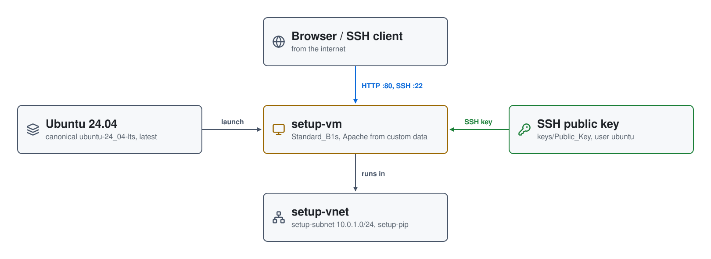

# Azure + Terraform Setup

The companion project to the
[Azure + Terraform: Easy Setup](https://youtu.be/NLnFxRdBlj4) video. It shows
how to give Terraform a service principal in an Azure subscription, then
proves the setup works by building the smallest useful thing: a VNet with one
subnet and an Ubuntu VM running Apache.


| Piece | Where | Role |
|---|---|---|
| **setup-vm** | `setup-subnet` (10.0.1.0/24) | `Standard_B1s`, Canonical Ubuntu 24.04; custom data installs Apache; SSH key from `keys/Public_Key` for user `ubuntu` |
| **setup-pip** | `setup-resource-group` | public IP with DNS name `setup-vm-<id>.centralus.cloudapp.azure.com` |
| **setup-vnet** | Central US | 10.0.0.0/16 |
| **setup-nsg** | `setup-resource-group` | rules for 22 and 80 from anywhere |

## Architecture

<picture>
  <source media="(prefers-color-scheme: dark)" srcset="architecture-dark.svg">
  
</picture>

Regenerate with `python3 make_diagram.py`.

Everything is in `main.tf`. `scripts/custom_data.sh` installs and starts
Apache. Bash and PowerShell versions of each script are included.

## Give Terraform access to Azure

You need an [Azure account](https://azure.microsoft.com/en-us/pricing/purchase-options/azure-account/).
Upgrade it to **Pay as you go** for these projects: the free offer can block
some services in some regions, in ways that are hard to predict.

1. **Subscription ID**: in the [Azure Portal](https://portal.azure.com/),
   open **Subscriptions** and copy the ID of the subscription Terraform will
   use.
2. **Tenant ID**: open **Microsoft Entra ID** (formerly Azure Active
   Directory); the **Tenant ID** is on the **Overview** page.
3. **App registration**: in Microsoft Entra ID, open **App registrations**,
   choose **New registration**, name it (for example `Terraform-SP`), keep
   the default account type and no redirect URI, and **Register**. Its
   **Application (client) ID** is on its **Overview** page.
4. **Client secret**: in the app's **Certificates & secrets**, add a client
   secret and copy its value immediately; it's shown only once.
5. **Role**: in the subscription's **Access control (IAM)**, add a role
   assignment of **Contributor** (under *Privileged administrator roles*) to
   the app registration.
6. Export the four values and sign in:

   ```bash
   export ARM_SUBSCRIPTION_ID="your-subscription-id"
   export ARM_CLIENT_ID="your-client-id"
   export ARM_CLIENT_SECRET="your-client-secret"
   export ARM_TENANT_ID="your-tenant-id"
   az login --service-principal --username "$ARM_CLIENT_ID" \
     --password "$ARM_CLIENT_SECRET" --tenant "$ARM_TENANT_ID"
   ```

   ```powershell
   $env:ARM_SUBSCRIPTION_ID = "your-subscription-id"
   $env:ARM_CLIENT_ID = "your-client-id"
   $env:ARM_CLIENT_SECRET = "your-client-secret"
   $env:ARM_TENANT_ID = "your-tenant-id"
   az login --service-principal --username $Env:ARM_CLIENT_ID `
     --password $Env:ARM_CLIENT_SECRET --tenant $Env:ARM_TENANT_ID
   ```

## Prerequisites

* [Install AZ CLI](https://learn.microsoft.com/en-us/cli/azure/install-azure-cli)
* [Install Terraform](https://developer.hashicorp.com/terraform/install)
* [Install Packer](https://developer.hashicorp.com/packer/install)

`check_env.sh` checks that `az`, `packer` and `terraform` are on your `PATH`
(Packer isn't used here, but the later projects need it), that the four
`ARM_*` variables are set, and that the service principal can sign in.

## Deploy

```bash
git clone https://github.com/mamonaco1973/azure-setup.git
cd azure-setup
./apply.sh       # or .\apply.ps1
```

The VM is created in Central US, in `setup-resource-group`; Terraform prints
its DNS name as `vm_public_fqdn`.

## Try it

1. Open `http://<vm_public_fqdn>`. Apache's test page appears once the custom
   data has finished, which can take up to 5 minutes.
2. SSH in with the project's key:

   ```bash
   ssh -i keys/Private_Key ubuntu@<vm_public_fqdn>
   ```

## Teardown

```bash
./destroy.sh     # or .\destroy.ps1
```

## Notes

- **Lab only.** The SSH key pair in `keys/` is committed to this public
  repository, so anyone can use the private key. Generate your own key pair
  for anything more.
- `setup-nsg` isn't associated with `setup-subnet` or the VM's NIC, so its
  rules don't apply. A Basic public IP with no NSG in effect leaves every
  port on the VM reachable from the internet.
